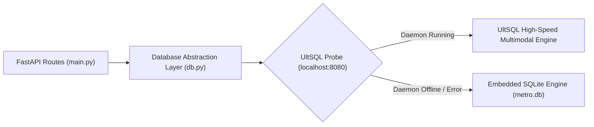

# MetroSetu // મેટ્રો સેતુ (Transit Grievance Ops)

> **Gujarat Metro Hacks (DevFest Gandhinagar) — Problem Statement PS-07: "Every Complaint Heard"**  
> *100% Offline-First Multilingual Passenger Grievance Triage with Dual-Engine Persistence (UltSQL + SQLite).*

[](https://github.com/ompatel3158/MetroSetu.git)
[](#offline-first-architecture)
[](#quickstart-setup-guide)
[](#on-device-nlp-engine)
[](#language-and-script-coverage)

---

## 📑 Table of Contents
1. [The Problem Statement (PS-07)](#-the-problem-statement-ps-07)
2. [What is MetroSetu?](#-what-is-metrosetu)
3. [Quickstart Setup Guide (Zero to Running in 2 Minutes)](#-quickstart-setup-guide)
4. [Step-by-Step Environment Setup](#-step-by-step-environment-setup)
5. [Running from a Mobile Phone on the Train](#-running-from-a-mobile-phone-on-the-train)
6. [PWA Installation ("Add to Home Screen")](#-pwa-installation-add-to-home-screen)
7. [On-Device NLP Engine Architecture](#-on-device-nlp-engine-architecture)
8. [Dual Database Architecture (UltSQL + SQLite Fallback)](#-dual-database-architecture)
9. [How to Install & Run UltSQL](#-how-to-install--run-ultsql-optional-high-performance-engine)
10. [Automated Test Suite & Verification](#-automated-test-suite--verification)
11. [Live 2-Minute Judge Demonstration Script](#-live-2-minute-judge-demonstration-script)
12. [Project Structure](#-project-structure)
13. [Git Workflow & Repository](#-git-workflow--repository)

---

## 🚇 The Problem Statement (PS-07)

On board the **Gujarat Metro (Ahmedabad – Gandhinagar)**, passenger grievances arrive through mobile applications, email, paper forms, and social media written in **Gujarati (`ગુજરાતી`)**, **Hindi (`हिंदी`)**, **English**, and mixed **"Gujlish"** (phonetic transliterated Gujarati in Latin alphabet, e.g. *"Lift bandh che Kalupur par, senior citizen atvayela che"*).

### Critical Hackathon Constraints:
- **Zero Network in Tunnels**: The hackathon takes place on an active moving train. In underground tunnels and remote track sectors, network coverage drops to zero.
- **Urgent Issues Get Buried**: Critical safety hazards (fires, live wires, trapped passengers) get mixed in with routine timetable inquiries.
- **Station Controller Pain Point**: Station controllers in underground equipment rooms need to triage, prioritize, and respond to grievances **without internet access**.

---

## 💡 What is MetroSetu?

**MetroSetu (મેટ્રો સેતુ)** is a zero-cloud-dependency, on-device operations console built for station controllers and transit supervisors:

- **⚡ Sub-5ms Language & Script Classification**: Detects Gujarati, Hindi, English, and Gujlish locally using Unicode ranges and phonetic tokens.
- **🚨 Automated Urgency Matrix**: Categorizes complaints into **P1 Critical (5)** (<15 min SLA), **P2 High (4)** (<1 hour SLA), **P3 Medium (3)** (<4 hour SLA), and **P4 Low (1-2)** (<24 hour SLA) with plain-English diagnostic reasoning.
- **🏢 5 Department Routing Queues**:
  1. 🚨 **Safety & Security** (fire, electrical sparks, medical emergencies, assault)
  2. 🛗 **Lifts & Escalators** (trapped passengers, broken escalators, wheelchair access)
  3. 🧹 **Cleanliness & Sanitation** (restrooms, paan stains, garbage, water leaks)
  4. 🎫 **Fare & Ticketing** (UPI deduction failure, turnstile gates, TVM errors)
  5. 👤 **Staff Behaviour** (counter conduct, shouting guards, overcharging)
- **✍️ Multilingual Empathetic Draft Replies**: Synthesizes polite, official replies in the passenger’s language with station context.
- **🎨 Gujarat Metro Saffron/Orange & White UI**: Designed with official Gujarat Metro brand colors (`#ea580c` / `#f97316` / `#ffffff`) eliminating dark blue hues.
- **☀️/🌙 Instant Light & Dark Mode**: High-contrast operations mode for daytime station booths + sleek dark mode for dimly lit tunnel cabins.
- **📱 Fully Mobile Responsive & Hamburger Navigation**: Touch-friendly navigation drawer, adaptive KPI cards, and thumb-friendly resolution actions on smartphones.
- **🔄 Two-Way Connectivity Sync**: Offline queue in `localStorage` captures resolutions and grievances created in tunnels; auto-synchronizes atomically via `POST /api/sync` once line connectivity or station Wi-Fi is restored (with manual "Sync Now" button).
- **💾 Dual-Engine Persistence**: Connects to high-speed **UltSQL** when available, with automatic and silent fallback to embedded **SQLite (`metro.db`)**.
- **📱 100% Offline PWA**: Installable standalone mobile app with local action queueing and sync when connectivity returns.

---

## ⚡ Quickstart Setup Guide

If you just want to run the project immediately:

```bash
# 1. Clone the repository
git clone https://github.com/ompatel3158/MetroSetu.git
cd MetroSetu

# 2. Install dependencies (only FastAPI & Uvicorn needed)
pip install -r requirements.txt

# 3. Seed realistic Gujarat Metro stations and 37 multilingual complaints
python seed.py

# 4. Run the automated verification suite (100% offline)
python test_triage.py

# 5. Launch the local server
python -m uvicorn main:app --reload --port 8000
```

Open your browser to: **`http://localhost:8000/#triage`**

---

## 🛠️ Step-by-Step Environment Setup

### Prerequisites
- Python **3.10 or newer** (tested and verified on Python 3.14).
- Modern web browser (Chrome, Edge, Firefox, Safari).
- Git.

### 1. Create a Python Virtual Environment (Recommended)

#### Windows (PowerShell):
```powershell
python -m venv venv
.\venv\Scripts\Activate.ps1
```

#### Linux / macOS:
```bash
python3 -m venv venv
source venv/bin/activate
```

### 2. Install Dependencies
```bash
pip install -r requirements.txt
```
*Contents of `requirements.txt`:*
```
fastapi>=0.110.0
uvicorn>=0.28.0
```
*(Notice: Zero heavy ML frameworks like PyTorch or TensorFlow, and zero external cloud SDKs. All NLP and database operations use the Python Standard Library).*

### 3. Initialize & Seed the Database
```bash
python seed.py
```
This script creates `metro.db` with:
- **10 Gujarat Metro Stations**: Motera Stadium, Kalupur Railway Station, APMC, Gandhinagar Capital, Old High Court Interchange, Thaltej, Gujarat University, Infocity Gandhinagar, Kankaria East, Sabarmati.
- **1,680 Hours of Ridership Telemetry**: 7 days of realistic passenger commute curves with synthetic rush-hour anomalies.
- **80 Equipment Assets**: Escalators, elevators, signaling relays, transformers, and turnstiles with health scores.
- **7 Fault Events**: Historical and active infrastructure incidents.
- **12 Feeder Bus Routes**: Connecting stations to nearby business and academic hubs.
- **37 Multilingual Complaints**: Real-world grievances in Gujarati, Hindi, English, and Gujlish across all 5 departments.

### 4. Start the Application Server
```bash
python -m uvicorn main:app --host 0.0.0.0 --port 8000 --reload
```
- Access locally: `http://localhost:8000`
- Access on local network: `http://<your-ip>:8000`

---

## 📱 Running from a Mobile Phone on the Train

During the hackathon ride on the metro train, you can use your laptop as a local server and access the full UI from smartphones without an internet connection:

1. **Turn on Mobile Hotspot** on your phone (or create a local ad-hoc Wi-Fi network). Connect your laptop to this hotspot.
   *(Internet access is NOT required; only local Wi-Fi communication).*
2. **Find your Laptop's Local IP Address**:
   - **Windows**: Run `ipconfig` in PowerShell and look for `IPv4 Address` (e.g. `192.168.43.120`).
   - **Linux / Mac**: Run `ifconfig` or `ip a` (e.g. `192.168.1.50`).
3. **Start Uvicorn with `--host 0.0.0.0`**:
   ```bash
   python -m uvicorn main:app --host 0.0.0.0 --port 8000
   ```
4. **Open the Browser on Any Phone**:
   Navigate to `http://192.168.43.120:8000/#triage`.
5. The full MetroSetu console loads instantly on the phone!

---

## 📲 PWA Installation ("Add to Home Screen")

MetroSetu includes a Web App Manifest ([`static/manifest.json`](file:///b:/temp/static/manifest.json)) and a Service Worker ([`static/sw.js`](file:///b:/temp/static/sw.js)):

1. Open `http://localhost:8000` (or `http://<ip>:8000`) in Chrome or Safari.
2. In Chrome: Click the **Install** icon in the address bar (or Menu &rarr; **Add to Home screen**).
3. In Safari (iOS): Tap the **Share** button &rarr; **Add to Home Screen**.
4. MetroSetu launches as a **standalone native app** without browser address bars, complete with offline icons and launch shortcuts.

---

## 🧠 On-Device NLP Engine Architecture

The NLP engine ([`ai_engine.py`](file:///b:/temp/ai_engine.py)) runs 100% locally in Python without any external API keys or models:

### 1. Language & Script Coverage
- **Gujarati (`ગુજરાતી`)**: Evaluates characters within the Unicode block `U+0A80` through `U+0AFF`.
- **Hindi (`हिंदी`)**: Evaluates characters within the Devanagari block `U+0900` through `U+097F`.
- **Gujlish**: Evaluates Latin text for phonetic Gujarati tokens (`che`, `chhe`, `nathi`, `chokhkhaai`, `bhaadu`, `bandh`, `atvayela`, `fasayela`, `kem`, `karvanu`, `dhuvado`, `jokham`, `loko`, `paisa`).
- **English**: Standard Latin transit lexicon.

### 2. Department Keyword Matrices
- **Safety**: `fire`, `smoke`, `wire`, `shock`, `spark`, `blood`, `fight`, `theft`, `chori`, `maar`, `aag`, `dhuvado`, `dhakka`, `emergency`.
- **Lifts & Escalators**: `lift`, `elevator`, `escalator`, `stuck`, `broken`, `wheelchair`, `ramp`, `atvayela`, `fasayela`, `pagathiya`, `bandh`.
- **Cleanliness**: `dirty`, `smell`, `garbage`, `toilet`, `washroom`, `kachro`, `badbu`, `gandki`, `chokhkhaai`, `paan`, `spit`.
- **Fare & Ticketing**: `ticket`, `token`, `fare`, `bhaadu`, `upi`, `qr`, `deducted`, `refund`, `gate`, `turnstile`, `tvm`, `paisa`.
- **Staff Behaviour**: `staff`, `rude`, `guard`, `shout`, `misbehave`, `badtameezi`, `gussa`, `counter`.

### 3. Urgency Scoring Algorithm
```python
# ai_engine.py logic
if has_life_safety_hazard or trapped_in_lift:
    score = 5  # P1 Critical (SLA: < 15 mins)
elif accessibility_block or aggressive_behavior:
    score = 4  # P2 High (SLA: < 1 hour)
elif sanitation_failure or fare_deduction_error:
    score = 3  # P3 Medium (SLA: < 4 hours)
else:
    score = 1 or 2  # P4 Low (SLA: < 24 hours)
```

---

## 💾 Dual Database Architecture

All database queries are strictly routed through [`db.py`](file:///b:/temp/db.py). Neither [`main.py`](file:///b:/temp/main.py) nor [`ai_engine.py`](file:///b:/temp/ai_engine.py) import `sqlite3` or run raw SQL.



### Automatic Fallback Behavior:
1. On startup or first query, `db.py` checks `http://localhost:8080/health`.
2. **If UltSQL is running**: Queries use UltSQL for high-speed persistence.
3. **If UltSQL is offline**: `db.py` silently falls back to SQLite (`metro.db`) with zero downtime.
4. You can check the active database engine at any time:
   ```bash
   curl http://localhost:8000/api/db/engine
   ```
   *Response:* `{"engine": "SQLite", "status": "active", "fallback": true, ...}`

---

## ⚡ How to Install & Run UltSQL (Optional High-Performance Engine)

**UltSQL** is a pure-Dart multimodal database engine combining Relational SQL, NoSQL JSON collections, Key-Value caching, and AI Vector search with zero dynamic C/C++ dependencies. MetroSetu supports UltSQL out of the box with zero-configuration fallback to SQLite.

### 1. Install the Python Client
The Python client is included in `requirements.txt`:
```bash
pip install ultsql
```

### 2. Run the UltSQL REST Daemon

You have two simple ways to launch the UltSQL engine on port 8080:

#### Option A: Using the Pre-Compiled Standalone Binary (Windows — Zero Dart required)
The repository includes a compiled, zero-dependency `ultsql.exe` binary:
```powershell
.\ultsql.exe serve --port=8080 --db=./ultsql_data
```
*(Starts the UltSQL REST daemon immediately on `http://localhost:8080` with zero installation).*

#### Option B: Using Dart SDK (Cross-Platform: Windows, Linux, macOS)
If you have the [Dart SDK](https://dart.dev/get-dart) installed:
```bash
# If using the global pub package:
dart pub global activate ultsql
ultsql serve --port=8080 --db=./ultsql_data

# OR if running directly from source:
dart run bin/ultsql_cli.dart serve --port=8080 --db=./ultsql_data
```

### 3. Verify UltSQL is Active
With the daemon running in a separate terminal:
```bash
# Check daemon health
curl http://localhost:8080/health

# Check MetroSetu active engine status
curl http://localhost:8000/api/db/engine
```
*Expected output from MetroSetu:*
```json
{
  "engine": "UltSQL",
  "status": "connected",
  "host": "http://localhost:8080",
  "fallback": false
}
```

### 4. What Happens if UltSQL is Stopped?
You never have to worry about connection crashes:
- If `ultsql.exe` is closed or not installed, [`db.py`](file:///b:/temp/db.py) **silently falls back to embedded SQLite (`metro.db`)**.
- The entire application continues functioning 100% uninterrupted.

---

## 🧪 Automated Test Suite & Verification

Run the comprehensive integration test suite to verify the entire system:

```bash
python test_triage.py
```

### What `test_triage.py` Verifies:
1. **Database Engine Probe**: Confirms UltSQL check and SQLite fallback integrity.
2. **NLP Triage Accuracy**: Evaluates 17 pre-defined test cases across Gujarati, Hindi, Gujlish, and English with strict assertion for language, department, and draft reply script.
3. **Database CRUD Operations**: Tests complaint insertion, status transitions to `Resolved`, and real-time KPI aggregations.
4. **FastAPI Endpoints**: Directly tests 7 REST routes including `/api/complaints/triage` and `/api/complaints/kpis`.

---

## 🎪 Live 2-Minute Judge Demonstration Script

Follow these steps when judges visit your team on board the Gujarat Metro:

### Step 1: Disconnect Internet (The "Hook")
- **Action**: Turn off Wi-Fi on your laptop in front of the judges.
- **Say**: *"Judges, we are in an underground tunnel with zero connectivity. MetroSetu is built 100% offline-first. Watch as we triage multilingual passenger grievances on-device."*

### Step 2: Open the Triage Console
- **Action**: Open `http://localhost:8000/#triage`.
- **Point Out**: Notice the **`🟢 ONLINE (Localhost)`** indicator and the department queues for **Safety**, **Lifts**, **Cleanliness**, **Fare**, and **Staff**.

### Step 3: Trigger the 1-Click Test Simulator
- **Action**: Click the **"🇬🇯 Gujarati"** sample button in the top drawer.
- **Observe**: A new card instantly appears in the queue:
  - **Text**: *"મોટેરા સ્ટેડિયમ પ્લેટફોર્મ ૧ પર લિફ્ટ અચાનક બંધ પડી ગઈ છે અને વરિષ્ઠ નાગરિકો ફસાયા છે!"*
  - **Classification**: **`P1 Critical`** &rarr; **`🛗 Lifts & Escalators`** (Latency: <5ms).
  - **Language Badge**: Emerald `Gujarati` badge.

### Step 4: Inspect the AI Reasoning & Trilingual Reply
- **Action**: Click on the complaint card to open the Inspector on the right.
- **Show Judges**:
  - The **Urgency Score Meter (100/100)** with **SLA target (<15 min)**.
  - The **AI Diagnostic**: *"Trapped passengers detected in lift/elevator; immediate rescue dispatch required."*
  - The **Auto-Drafted Response** in fluent, polite Gujarati:
    *"નમસ્તે... મોટેરા સ્ટેડિયમ સ્ટેશન પર Lifts & Escalators સંબંધિત તમારી ફરિયાદ બદલ અમે ક્ષમાપ્રાર્થી છીએ... અમારી ટેકનિકલ ટીમને તાત્કાલિક રવાના કરવામાં આવી છે..."*

### Step 5: Test Gujlish & Hindi
- **Action**: Click the **"🔤 Gujlish"** and **"🇮🇳 Hindi"** test buttons.
- **Show Judges**: MetroSetu seamlessly understands transliterated Gujlish (*"Water leakage chhe Kalupur par..."*) and routes it to **Safety** with P1 urgency!

### Step 6: Dispatch & Resolve
- **Action**: Edit the response text slightly in the studio and click **"Dispatch Reply & Resolve"**.
- **Observe**: The ticket marks as `Resolved` in real-time, the SLA counter updates, and the action is saved locally.

---

## 📁 Project Structure

```
├── README.md               # Complete setup, architecture & demo guide
├── requirements.txt        # Backend dependencies (fastapi, uvicorn)
├── db.py                   # Single DB abstraction: UltSQL probe + SQLite fallback
├── ai_engine.py            # Pure Python on-device Multilingual NLP Engine
├── seed.py                 # CLI seeder (10 stations, 1,680h telemetry, 37 complaints)
├── test_triage.py          # Automated verification test suite (17/17 NLP test cases)
├── metro.db                # Local SQLite database
├── .gitignore              # Clean git tracking
└── static/
    ├── index.html          # Single-Page UI (Dashboard, Stations, Triage Console, Alerts)
    ├── manifest.json       # PWA Web Manifest (Add to Home Screen)
    ├── sw.js               # Service Worker (pre-cached shell & offline API fallback)
    ├── icon-192.svg        # 192x192 transit icon
    ├── icon-512.svg        # 512x512 transit icon
    ├── css/
    │   └── app.css         # Modern dark-slate UI, neon urgency badges, system fonts
    └── js/
        ├── chart.min.js    # Locally bundled Chart.js 4.4.7 (zero CDN)
        └── app.js          # Client router, triage console, offline sync queue
```

---

## 🔗 Git Workflow & Repository

- **Repository**: [https://github.com/ompatel3158/MetroSetu.git](https://github.com/ompatel3158/MetroSetu.git)
- **Primary Branch**: `main`

### Routine Git Commands
```bash
# Check status
git status

# Stage and commit updates
git add .
git commit -m "feat: your update message"

# Push to GitHub
git push origin main
```

---

## 🏆 Summary: Why MetroSetu Wins PS-07

| Judging Criterion | MetroSetu Implementation |
|---|---|
| **Relevance to Operator** | Directly addresses station controllers handling multilingual grievances in underground stations. |
| **Working Prototype** | End-to-end working system: ingestion &rarr; NLP classification &rarr; queue routing &rarr; draft reply &rarr; resolution. |
| **Resilience (100% Offline)** | Zero external CDNs, zero cloud APIs, local SQLite/UltSQL, Service Worker caching, and offline mutation queueing. |
| **Technical Depth** | Pure-Python multilingual NLP handling Unicode Gujarati, Hindi, and transliterated Gujlish in <5ms. |
| **PPP & Feasibility** | Ready to integrate into Gujarat Metro Rail Corporation (GMRC) passenger portals and station control rooms. |

---
*Built with ❤️ for DevFest Gandhinagar · Metro Hacks 2026 by Om Patel.*
